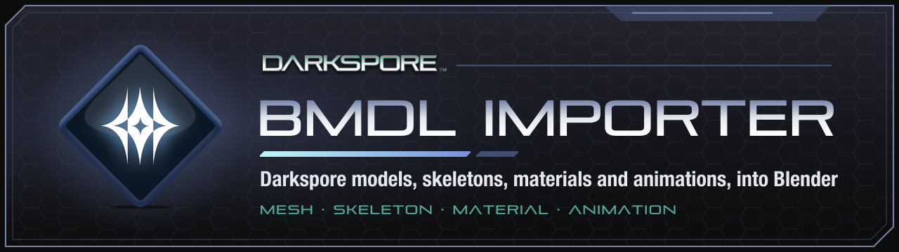
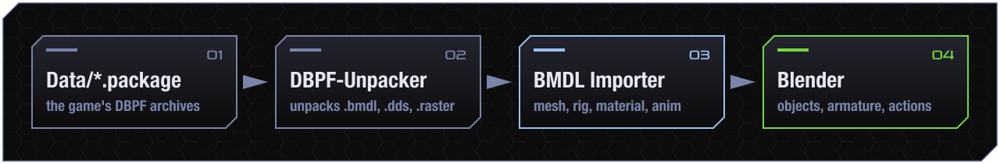

<div align="center">




[](https://github.com/JeanxPereira/BMDL-Importer/actions/workflows/ci.yml)
[](https://github.com/JeanxPereira/BMDL-Importer/releases)
[](https://github.com/JeanxPereira/BMDL-Importer/issues)

</div>

## 

`.bmdl` is Darkspore's model container: a relocatable graph holding the geometry, the
skeleton, the materials, and the embedded animations. This add-on parses that container and
rebuilds it in Blender — meshes, a weighted armature, materials, and baked actions.

The material and animation behaviour is reconstructed from the game's actual data and shader
math (recovered by reverse engineering), not approximated. See the documents under `docs/` for
the full format and the reasoning behind every field.

<p align="center"></p>

The game keeps its models inside DBPF packages; unpack them with
[DBPF-Unpacker](https://github.com/JeanxPereira/dbpf_unpacker) and point the importer at the loose
`.bmdl` files.

## 

- Imports `.bmdl` meshes, auto-detecting index size and triangle layout.
- Builds an armature from the file's skeleton and binds meshes with vertex weights.
- Imports embedded animations as actions (location / rotation / scale per bone), using a
  closed-form bake that matches the game's parent-relative local transforms.
- Reconstructs materials data-driven from the per-material parameters, covering all of
  Darkspore's labs shader families (lit, chrome/reflective, crystal, terrain mix, foliage,
  unlit/FX, and more).
- Resolves textures by filename and by Darkspore FNV-1 hash, with a bounded folder search.
- Writes detailed per-mesh, texture, and animation logs next to the imported file.

## 

- Blender 4.5 or newer (tested on 5.1; CI installs and enables it on 4.5 LTS and 5.2). The new
  slotted Action system is used, with a fallback for legacy actions.
- License: GPL-3.0-or-later.
- Authors: JeanxPereira, foehammer.

## 

**From Blender, with updates** (recommended): Edit > Preferences > Get Extensions >
Repositories > **+** > *Add Remote Repository*, and paste

```
https://jeanxpereira.github.io/BMDL-Importer/index.json
```

Then search for *Darkspore BMDL Importer* in Get Extensions and install it. Blender offers every
new release as an update.

**From a zip**: download `io_darkspore-<version>.zip` from
[Releases](https://github.com/JeanxPereira/BMDL-Importer/releases), then Edit > Preferences >
Get Extensions > ⌄ > *Install from Disk*.

Either way the importer is at File > Import > Darkspore (.bmdl).

**From source**: the repository root is the extension (`blender_manifest.toml` next to
`__init__.py`).

```sh
mkdir -p dist && blender --command extension build --output-dir dist   # dist/io_darkspore-<version>.zip
sh tools/ci_blender.sh blender dist/io_darkspore-*.zip  # the CI check: validate, install, enable
```

For development, link the clone into your extensions folder as `user_default/io_darkspore`
and reload scripts after each change.

**Releasing**: bump `version` in `blender_manifest.toml`, push a tag `vX.Y.Z`; the release
workflow builds and validates the extension, attaches the zip to a GitHub release and republishes
the extensions repository on GitHub Pages.

## 

### From the UI

1. File > Import > Darkspore (.bmdl).
2. Select one or more `.bmdl` files.
3. Optionally enable Import Textures and either keep the default search (nearby
   `~animations` / `animations~` folders) or set a custom texture directory.
4. Optionally enable Import Animations to bake actions onto the created armature.
5. Import.

### From Python

```python
import bpy

bpy.ops.import_scene.io_darkspore(
    filepath="D:/Darkspore/models/example.bmdl",
    import_textures=True,
    use_custom_texture_dir=True,
    textures_dir="D:/Darkspore/textures",
    import_animations_opt=True,
    join_renderables=True,
    flip_v=True,
)
```

## 

- Import Textures: resolve and link textures (by name or FNV-1 hash). With Use Custom Texture
  Path, search a chosen directory; otherwise search candidate folders near the `.bmdl`.
- Import Animations: bake the embedded actions onto the generated armature.
- Join Renderables: merge a mesh's renderable slots into one object (material slots preserved).
- Flip V: flip the V coordinate on UV write (correct for most DDS/TGA sources).
- Apply Custom Normals: inject decoded vertex normals as split normals (skipped on very large meshes).
- Preview UV (Checker): assign a UV-checker material for inspection.
- Axis Forward / Axis Up / Apply Axis to Vertices: orientation conversion for geometry and animation.
- Debug Log / Dry Run: diagnostics; Dry Run scores index modes without building meshes.

## 

Each material names a shader (for example `labsChromeVertColor`) plus a packed parameter block
and a set of texture and vertex-stream bindings. The importer reads those parameters and builds
a node graph per shader family:

- Lit / terrain shaders use a Principled BSDF with the packed normal map decoded correctly
  (the normal map stores gloss in R, normal X/Y in A/G, spec exponent in B), roughness from
  gloss, specular from the material's specular tint and level, and emission from the diffuse
  alpha (the glow mask).
- Reflective shaders (chrome, tech) add a gloss-masked environment reflection.
- Crystal shaders use glass-like transmission with fresnel reflection.
- The terrain SuperMix shader blends four layers as a weighted sum driven by the normalised
  vertex-colour channels, each layer with its own tiling and tint.
- Unlit and FX shaders use an Emission shader (additive or alpha-blended as appropriate).

The full format, the 33-shader catalog with exact per-shader math, and the known limitations are
documented in [docs/BMDL_MATERIALS.md](docs/BMDL_MATERIALS.md).

## 

Animation tracks store parent-relative local transforms (translation / quaternion rotation /
scale) per bone, sampled at keyframe times. The importer composes these up the bone hierarchy
and bakes the result onto the armature's pose bones. The format and the bake math are documented
in [docs/BMDL_ANIMATION.md](docs/BMDL_ANIMATION.md).

## 

Each import writes sidecar logs next to the source file:

- `<file>.darkspore_import.log.txt` — per-mesh scan: chosen index mode, vertex counts, segments.
- `<file>.darkspore_import.missing_textures.log.txt` — which hints/hashes were searched and resolved.
- `<file>.darkspore_anim.log.txt` — animation parsing summary.

## 

- Darkspore is a deferred renderer; Blender's forward shading approximates the lit term using
  scene lights.
- Per-material environment maps are stored as 6-face cubemap strips, which Blender cannot sample
  natively as a cube; the reflection is approximated.
- Terrain SubMix decal layers blend softly through the deferred decal pass; imported as separate
  opaque meshes they show hard polygon edges. The geometry and textures are faithful.

## 

| What | Where |
|---|---|
| Binary parsing: header/graph, model, skeleton, meshes, materials, animation decode | `bmdl_core.py` |
| Standalone schema of the format (no Blender needed) | `bmdl_schema.py` |
| Operator, options, import flow | `__init__.py` |
| Mesh build: geometry, UVs, vertex colours, normals | `io_mesh.py` |
| Data-driven material builder (all labs shader families), texture search | `io_material.py` |
| Armature, bind-pose transforms, skinning | `io_armature.py` |
| Closed-form animation bake | `io_anim.py` |
| Axis-matrix helper, Darkspore FNV-1 hash | `utils.py` |
| Format reference | [BMDL_FORMAT](docs/BMDL_FORMAT.md), [BMDL_MATERIALS](docs/BMDL_MATERIALS.md), [BMDL_ANIMATION](docs/BMDL_ANIMATION.md) |
| Corpus validator: `python tools/validate_bmdl.py <dir of .bmdl>` | `tools/validate_bmdl.py` |
| CI check of a built extension | `tools/ci_blender.sh`, `.github/workflows/` |
| This README's art | `tools/readme_art.py` |

The banner and headers are set in Darkspore's own UI fonts (EA Pirulen, Helvetica Neue Condensed
Bold) in the look of its front-end frames, regenerated from the game's `UI.package` with
`python tools/readme_art.py <Darkspore/Data>` (Pillow, fontTools). Only the SVGs are kept;
nothing from the game is stored.

## 

- foehammer — specs and prior research into Darkspore formats.
- Community research on Darkspore/Spore file structures and hashing.

---

Menu path: File > Import > Darkspore (.bmdl)
Issue tracker: https://github.com/JeanxPereira/BMDL-Importer/issues/

<div align="center"><sub>Darkspore, its lettering and its wordmark belong to Electronic Arts / Maxis; this is a fan project and ships no game data</sub></div>
